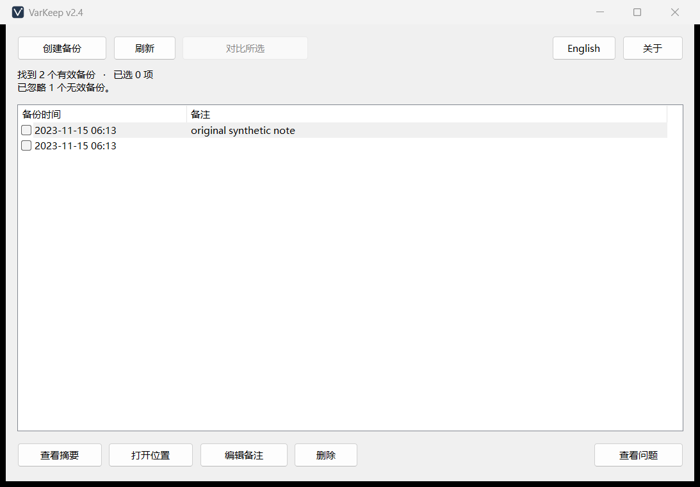

<div align="center">


# VarKeep

**Keep a local backup you can inspect and restore before changing Windows environment variables.**

Save a snapshot, compare changes, then review and run a restore script when you need it.

[](https://github.com/V-ChuXuan/VarKeep/releases)
[](#install)
[](LICENSE)

[Download](https://github.com/V-ChuXuan/VarKeep/releases) · [Quick Start](#quick-start) · [GUI guide](v2/README.md) · [简体中文](README.md)

</div>

## Demo



The screenshot uses synthetic backups and contains no real environment variables.

## Install

**Requirements: Windows 10/11 x64.** Download from [Releases](https://github.com/V-ChuXuan/VarKeep/releases) and extract into a local directory that is not automatically synchronized.

| Version | Download | Run | Default backup directory |
| --- | --- | --- | --- |
| **v2 GUI (recommended)** | `varkeep-v2-windows-x64.zip` | Open `varkeep.exe`; no Rust or PowerShell installation needed | `backups/` beside the EXE |
| v1 CLI/TUI | `varkeep-v1-cli.zip` | Install [PowerShell 7](https://learn.microsoft.com/powershell/scripting/install/installing-powershell-on-windows), then open `start-interactive.cmd` | `backups/` beside the script |

The versions store and manage their backups independently. Neither reads, migrates, or deletes the other's data. For command-line or numbered-menu use, see the [v1 CLI/TUI guide](v1/README.md).

Each release also includes `SHA256SUMS.txt` to check the ZIP's SHA-256. After extraction, continue with the steps below.

## Quick Start

1. Open `varkeep.exe` and choose Create backup. Creating a snapshot does not require administrator privileges.
2. Select a history row and choose View summary to inspect it. Add a note to record why you made the backup.
3. Check one backup to compare it with the current persistent environment, or two backups to compare older → newer.
4. To restore, choose Open location, review the scripts in `restore/`, and manually run the one you need.

The app does not run restore scripts or request administrator privileges for you. System restoration requires a trusted administrator PowerShell session that you open yourself; see [Usage](#usage).

## Features

- Capture user and system environment variables while preserving `REG_SZ` and `REG_EXPAND_SZ` types.
- Generate a complete snapshot, a best-effort redacted summary, and user, system, and combined restore scripts.
- Compare added, removed, value-changed, or type-changed variables; GUI results name the comparison direction and identify PATH order-only changes.
- View summaries, edit notes, open locations, and confirm deletion from a native history list, with Chinese, English, and keyboard entry points.
- Inspect invalid backup names and reasons; failed note saves retain the previous content and your draft.

See the [v2 guide](v2/README.md) for GUI actions and capacity limits, or the [v1 guide](v1/README.md) for CLI commands, detailed comparison reports, and numbered menus.

## Usage

**Backup contents** consist of five core files:

```
env-backup-…/
├─ snapshot.json
├─ summary.md
└─ restore/
   ├─ user.ps1
   ├─ system.ps1
   └─ all.ps1
```

`snapshot.json` and the restore scripts contain complete plaintext values. `summary.md` provides a length-limited, best-effort redacted preview. v1 also captures the process environment for viewing and comparison; process variables are not restored. v2 adds `note.txt` when you save a note.

| Restore script | Writes to | Requirement |
| --- | --- | --- |
| `user.ps1` | The Windows account running the script | Run as the account you intend to restore |
| `system.ps1` | System environment variables | Administrator PowerShell |
| `all.ps1` | Current account and system environment variables | Administrator PowerShell; verify the account first |

Restore scripts write only variables in the snapshot and do not delete variables added later. Restoration is not transactional: a failure can leave some variables already written. Review the script first and avoid editing environment variables during restoration. The scripts broadcast the change afterward; running applications usually still need a restart.

Backups stay with the application directory. Moving the EXE alone does not move existing backups; close the app and move the whole directory when migrating. Once there are 64 backup candidates, organize them manually before creating another. See the [v2 guide](v2/README.md) for its additional history limits.

## Limitations

**Security reminder: backups are not safe to share publicly.** Environment variables can contain tokens, passwords, connection strings, and private paths, which summary redaction may miss. Keep `backups/` out of Git, cloud drives, and other automatically synchronized directories.

VarKeep does not encrypt backups or replace inherited Windows ACLs. Integrity validation detects ordinary corruption and unexpected layouts; it cannot prove that someone with local write access has not replaced the whole backup. The tool does not provide automatic restoration or full system rollback.

See [SECURITY.md](SECURITY.md) for the threat model, account and privilege boundaries, and vulnerability reporting.

## Development

Source development requires Windows x64, PowerShell 7, and the pinned Rust 1.97.0 toolchain. From the repository root, run:

```powershell
pwsh -NoProfile -File .\scripts\verify.ps1
pwsh -NoProfile -File .\scripts\package-release.ps1
```

Verification covers synthetic default tests, formatting, Clippy, and the license inventory. Packaging also builds and checks release files, producing two ZIPs and `SHA256SUMS.txt` under `dist/`. Packaging replaces release outputs; read [CONTRIBUTING.md](CONTRIBUTING.md) first. Local verification and packaging are enough to prepare a release; CI/CD is optional.

See the [v2 development guide](v2/README.md#从源码开发) for GUI development, and [CHANGELOG.md](CHANGELOG.md) for version changes.

## License

VarKeep source is released under the [MIT License](LICENSE).

The GUI uses native Windows controls and requires no additional UI attribution component. Release archives retain the [third-party notices](v2/THIRD-PARTY-NOTICES.md) and [dependency license texts](v2/THIRD-PARTY-LICENSES.txt).

<p align="center"><sub>If VarKeep helps you, a ⭐ can help others with the same need discover it.</sub></p>